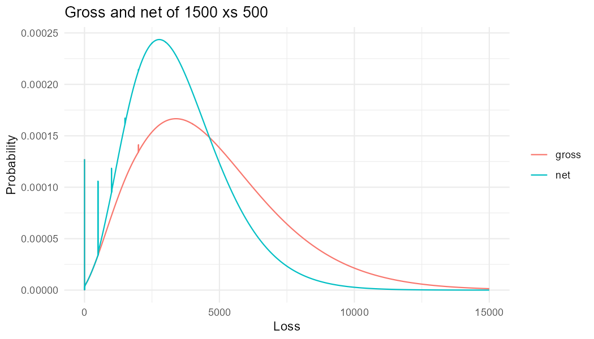

# aggregateR

`aggregateR` puts the [`aggregate`](https://github.com/mynl/aggregate) actuarial library in R. You write a program in DecL, the library's language for compound loss distributions, build it on an [`aggregate-api`](https://github.com/mynl/aggregate_api) server, and read back exhibits, quantiles and whole frames as data frames. R never hosts Python: the package talks HTTP to the server, through the same API the aggregate Excel add-in uses.

## Install

The package is pure R and needs R 4.1 or later. Install its four dependencies from CRAN, then the package from GitHub:

```r
install.packages(c("httr2", "jsonlite", "nanoparquet", "processx"))
install.packages("https://github.com/mynl/aggregate-R/archive/refs/heads/master.tar.gz",
                 repos = NULL, type = "source")
```

This route needs no Rtools on Windows. `pak::pak("mynl/aggregate-R")` also works and fetches the dependencies itself, but on Windows it requires Rtools even though the package has no compiled code.

## Choose a server

**Your programs are your data.** By default the package talks to the public server, `https://agg.mynl.com`, which builds every program you send it and keeps an audit record of each. For real work, `agg_start()` runs a private server on your own machine, bound to `127.0.0.1`, and points the session at it:

```r
library(aggregateR)
agg_start()     # a private local server for this R session
agg_server()    # the current server, now http://127.0.0.1:<port>
```

`agg_start()` needs [uv](https://docs.astral.sh/uv/) (`winget install astral-sh.uv` on Windows), which installs the server into an environment of its own; the first start downloads it, which can take a couple of minutes. `agg_stop()` stops the server, and so does quitting R.

**Until `aggregate-api` 1.26 or later is on PyPI,** tell `agg_start()` where to get it:

```r
agg_start(from = "aggregate-api[parquet] @ git+https://github.com/mynl/aggregate_api")
```

To use a server you run yourself, `agg_server("http://127.0.0.1:8000")` points the session at it; to make that stick, set `AGGREGATER_SERVER` in `.Renviron`.

## A first session

The session below builds a book gross and net of an excess of loss treaty, compares their quantiles, plots both distributions, and reads a portfolio's exhibits. Run it a line at a time in RStudio. The plot needs ggplot2 (`install.packages("ggplot2")`); nothing else does.



```r
library(aggregateR)
library(ggplot2)

# One line of DecL builds a distribution: 20 expected claims, gamma mixed
# Poisson frequency (mixing cv 0.4), and a lognormal severity with mean 250
# and cv 2, limited to 2000.
gross <- agg_build("agg Gross 20 claims 2000 xs 0 sev lognorm 250 cv 2 mixed gamma 0.4")
gross                     # the handle: grid, mean, cv and a validation check

# The same book net of a 1500 xs 500 per occurrence excess of loss treaty.
net <- agg_build("agg Net 20 claims 2000 xs 0 sev lognorm 250 cv 2 occurrence net of 1500 xs 500 mixed gamma 0.4")
p <- c(0.5, 0.9, 0.99, 0.996)
rbind(gross = agg_q(gross, p), net = agg_q(net, p))   # exact quantiles
#>        50%  90%   99% 99.6%
#> gross 4257 8207 12490 14027
#> net   3269 5878  8656  9647

# The whole distribution, every bucket, as a data.frame.
dg <- agg_frame(gross)
dn <- agg_frame(net)
dim(dg)                   # 65,536 rows
both <- rbind(data.frame(loss = dg$loss, p = dg$p_total, book = "gross"),
              data.frame(loss = dn$loss, p = dn$p_total, book = "net"))
ggplot(subset(both, loss <= 15000), aes(loss, p, color = book)) +
  geom_line() +
  labs(x = "Loss", y = "Probability", color = NULL,
       title = "Gross and net of 1500 xs 500") +
  theme_minimal()
# The spikes are exact probability masses: no claims at 0, the gross limit at
# 2000, and net claims capped at 500 stacking at multiples of 500.

# A portfolio of two units, Property and Casualty, and its exhibits.
book <- agg_build(c("port Book",
                    "  agg Property 80 claims 500 xs 0 sev lognorm 50 cv 1.2 poisson",
                    "  agg Casualty 20 claims 2000 xs 0 sev lognorm 250 cv 2 mixed gamma 0.4"))
agg_exhibits(book)        # the exhibits on offer
agg_exhibit(book, "summary")   # moments and percentiles by unit, caption included
rp <- agg_exhibit(book, "tail")$tables$tail_df
rp[rp$unit == "total" & rp$P >= 0.9, ]   # VaR and TVaR by return period

# The example library.
lib <- agg_library()      # 198 example programs, by name and kind
head(lib, 20)
cat(agg_program("TwoLineBook"))   # the book above, as the library writes it
```

The quantiles shown were computed with `aggregate` 1.5.2. A local server runs whatever release of the library uv installs, which can give different numbers; `agg_meta()` shows the version.

## Server facts

```r
meta <- agg_meta()
meta$version            # the server's version
meta$aggregate_version  # the library's version
meta$log2_cap           # the largest grid the server builds
```

## Build

`agg_build()` sends a DecL program to the server and returns a handle:

```r
a <- agg_build("agg A 10 claims sev lognorm 10 cv 1 poisson")
a
#> <agg_handle> agg.A #b4f2301771f7c82d
#>   server      http://127.0.0.1:23456
#>   grid        log2 16, bs 0.03125
#>   mean, cv    100, 0.447
#>   validation  not unreasonable
agg_build("(2+2)")   # a program that evaluates to a number returns it
#> [1] 4
```

- **The same program on the same grid is sent once per R session.** Building it again returns the handle without a request.
- **A program can name your earlier declarations:** `agg_build("port P agg.A agg.Capstone.Gross")`. If the server restarts and forgets `A`, the client builds `A` again and retries.
- **Handles persist.** A handle carries its program and server, so one saved with `saveRDS()` works in a later R session. If the server has dropped the object, the next read rebuilds it.

## The example library

```r
agg_library()                            # name and kind of every entry, in file order
cat(agg_program("BasicBook"))            # an entry's program, ready to read or edit
gross <- agg_build(agg_program("Capstone.Gross"))
```

The listing is fetched once per R session. Programs can also name library entries directly, as in `port P agg.A agg.Capstone.Gross`.

## Exhibits and quantiles

Every function below takes a handle, or a program in its place: a program is built first, on the server's default grid, and the memo means passing the same program again costs no build.

```r
agg_exhibits(a)                  # name, title, perspectives
ex <- agg_exhibit(a, "summary")
ex$title                         # "Summary: A"
ex$captions                      # one caption per block, named by block key
ex$tables$summary_df             # a data.frame: row labels as text, values as raw numbers
ex                               # prints the title, then each block's caption and table
agg_q(a, c(0.5, 0.99, 0.995))    # exact grid quantiles, named "50%", "99%", "99.5%"
```

`agg_exhibit()` always returns a list, whether the exhibit has one block or several. The tables hold data only: the server's display formatting is dropped, a label spanning rows is repeated down each row, and header levels join into column names such as `occ Gross`.

## Whole frames

```r
agg_frames(a)                    # name, rows, columns of every frame the object has
density <- agg_frame(a)          # density_df, every row and column, as a data.frame
```

When the server offers Parquet, frames arrive as Parquet, bit-exact and fast: 65,536 rows by 33 columns read in 0.06 s from a local server, against 5.5 s through CSV. Otherwise they arrive as CSV.

## Errors

Every error the package raises inherits `aggregateR_error`, so `tryCatch()` can select by class:

- `aggregateR_refusal`: the program or an argument is wrong. A parse error reads `line L, col C: message`.
- `aggregateR_transient`: the server was unreachable, timed out, faulted, or kept rate limiting after three retries. A later retry may succeed.
